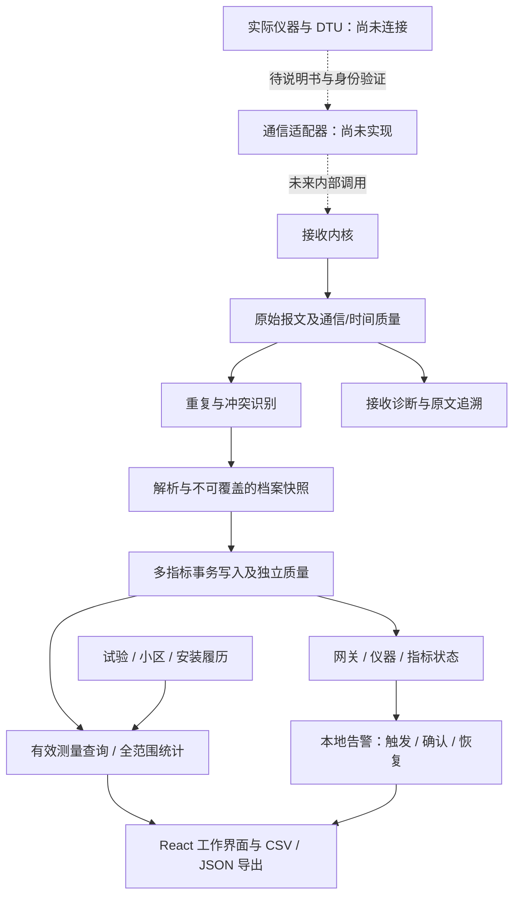

# 架构与运行边界

后端沿用 Node.js / Fastify / better-sqlite3，前端沿用 React / Vite / React Router / Lucide；本轮没有升级主要框架或引入第二套 UI/数据库体系。SQLite 是本项目的独立实例。

`backend/src/app.js` 管理独立网关/仪器；`telemetry-api.js` 提供详情、档案、分析和导出；`operations.js` 提供试验、安装、告警处置与审计。查询共同使用 `queries.js` 的筛选条件，避免分页、统计和导出采用不同时间口径。

`ingest.js` 先保留原始字节，再检查来源绑定、重复与协议档案；结构不合法的多指标批次不会部分入库。可解码的不同指标分别保留质量，异常指标不会删除同报文的有效兄弟指标。JSON 内的自报来源或设备编号不构成认证。

`status.js` 按实际证据计算状态；当前档案的指标时效影响当前判定，但不修改旧报文的版本快照或语义。`alarms.js` 依靠状态与新观测恢复证据，服务运行时每 30 秒评估，读取告警时也即时评估。本地规则不发通知、不执行设备命令。

安装关系按设备采集时间匹配半开区间 `[start_at,end_at)`；查询不把接收时间当成安装归属依据。统计针对完整有效记录，图表显示有限观测点且不填补缺测。没有连续采样间隔依据时，不绘制暗示连续观测的连线。

业务服务只绑定 127.0.0.1。用户认证、设备凭据、真正的协议适配器与公网部署另行设计。自动测试使用临时数据库；GitHub Actions 同样不连接业务库、DTU 或阿里云。
